# 시나리오 맵 표 (자동 생성: python -m scenarios --images)

맵마다 시작 상태를 그린 그림입니다. 단계형 맵은 단계를 옆으로 이어 그렸습니다. A/B 원은 에이전트 시작 위치, 선은 바라보는 방향입니다. 비밀 값(정답, 배선, 주기, 경로)은 그림에 없습니다.

전체 맵 한 장: [map_images/all_maps.png](map_images/all_maps.png)

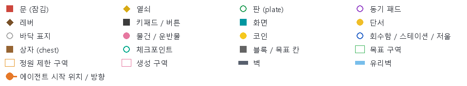

| 맵 | 이름 | 계열 | 단계 | 내용 | 그림 |
|---|---|---|---|---|---|
| `s01_deadlock` | 교착 상태 | 순서 계획 | 3 | 각자의 압력판이 '상대 방' 문을 열어 주는 대칭 교착. 단계형 3단계. | 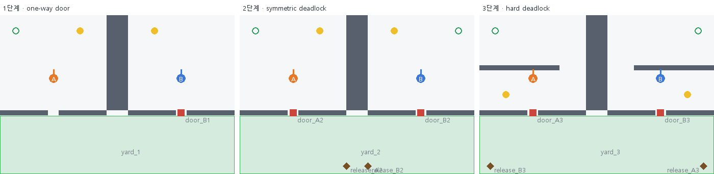 |
| `s02_leapfrog` | 징검다리 교대 | 순서 계획 | 3 | 문마다 '한 명이 판을 밟아 주고 한 명이 넘어가기'로 번갈아 통과. 단계형 3단계. | 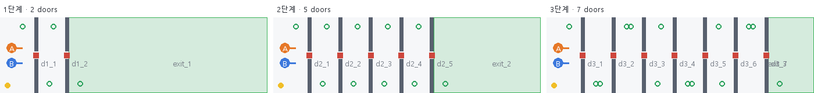 |
| `s03_split_experiment` | 나눠 보는 실험 | 공동 추론 | - | 숨은 배선(XOR)으로 문 4개를 여는 레버 6개, 문 상태는 각자 절반만 보임. | 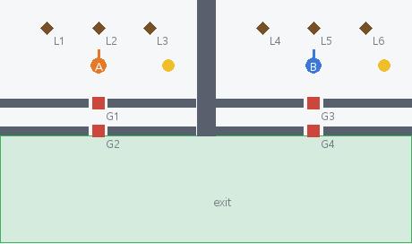 |
| `s04_half_mastermind` | 반쪽 마스터마인드 | 공동 추론 | 3 | A는 색 코드를 입력만, 결과(맞은 개수)는 B의 방 화면에만 나옴. 단계형 3단계. | 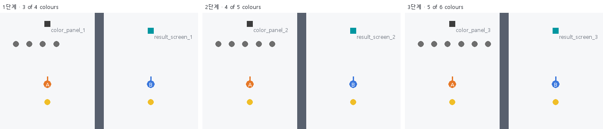 |
| `s05_lossy_sync` | 확인의 문제 | 통신 규약 | - | **평가 제외**: 시작이 대칭이라 소통 없이 각자 판으로 걸어가도 같은 step에 도착함 (생각 없는 정책 20회 중 18회 클리어). (원래 내용: 메시지가 사라지거나 늦게 오는 상황에서 '같은 step'에 판 밟기.) | 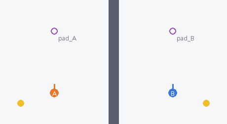 |
| `s06_short_radio` | 짧은 무전 | 통신 규약 | 3 | **평가 제외**: 정답이 쪽지에 그대로 있어 전달만 하면 끝남 (협력 난이도가 낮음). (원래 내용: 10자/5 step 제한 무전으로 상대 방 4x4 패널의 순서를 서로 전달. 단계형 3단계.) | 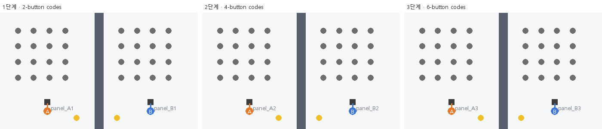 |
| `s07_me_vs_us` | 나 vs 우리 | 사회적 딜레마 | - | 곧 사라지는 개인 보너스 보석 vs 둘이 함께 옮겨야 하는 팀 상자. | 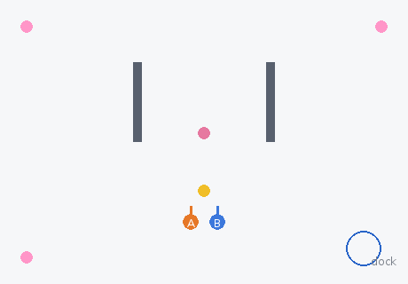 |
| `s08_boring_role` | 지루한 역할 | 사회적 딜레마 | - | 누군가 판을 지켜야 정원 문이 열림. 판 지키기는 개인 점수 0. | 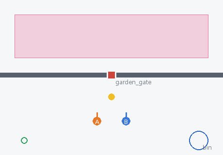 |
| `s09_shared_budget` | 공동 예산 | 작업 분배 | - | 숨은 체크포인트 8곳을 누가 가든 다 방문. 팀 총 이동거리로 평가. | 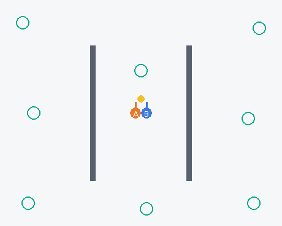 |
| `s10_moving_world` | 움직이는 세계 | 시간 예측 | - | **평가 제외**: 주기를 관찰하지 않고 무작정 진입하는 풀이가 나타남 (2026-10-15 보강했지만 평가에서는 제외). (원래 내용: 주기가 다른 두 문이 함께 열리는 미래 시점을 추론해 동시에 통과.) | 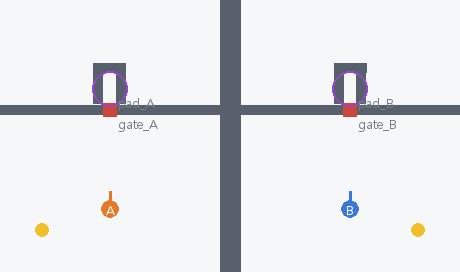 |
| `s11_pincer` | 포위 | 시간 예측 | 3 | 기둥을 도는 2인용 코어를 둘이 같은 순간 붙잡아 함께 운반. 단계형 3단계. | 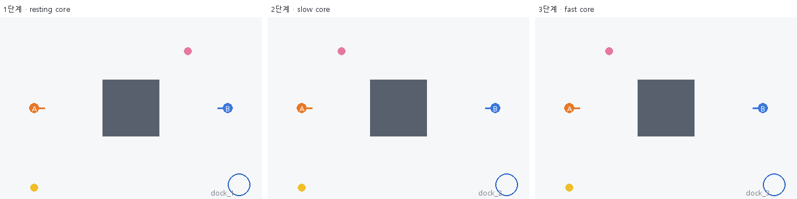 |
| `s12_unreliable_eyes` | 믿을 수 없는 눈 | 신뢰, 검증 | - | 같은 단서가 에이전트마다 다른 곳이 틀려 보임. 비교+검산으로 코드 복원. | 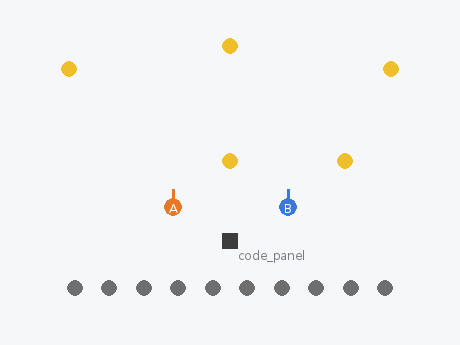 |
| `s13_crossed_testimony` | 엇갈린 증언 | 신뢰, 검증 | 3 | MAP_GUIDE.md 기준으로 만든 단계형 맵. 축 B + C. | 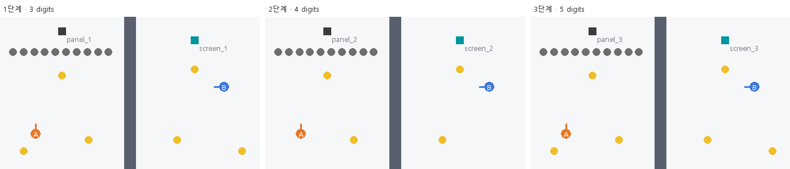 |
| `s14_silent_porters` | 말없는 운반 | 몸 조율 | 3 | MAP_GUIDE.md 기준으로 만든 단계형 맵. 축 A + E. | 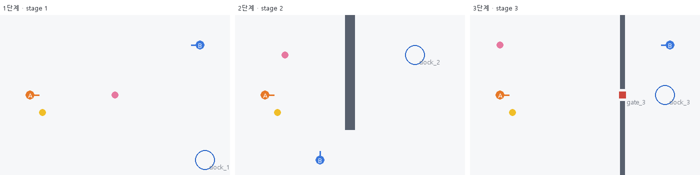 |
| `s15_glass_division` | 유리벽 분업 | 작업 분배 | 3 | MAP_GUIDE.md 기준으로 만든 단계형 맵. 축 C + D. | 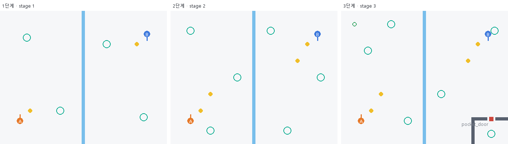 |
| `s16_remote_maze` | 원격 조종 미로 | 실시간 원격 협조 | - | 유리벽 밖 B가 레버로 미로 문을 바꿔 A를 통과시킴. | 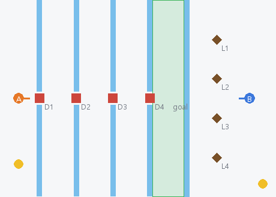 |
| `s17_push_blocks` | 함께 밀기 | 순서 계획 | - | 둘이 같은 step에 같은 방향으로 밀어야 움직이는 블록 2개를 목표 칸에. | 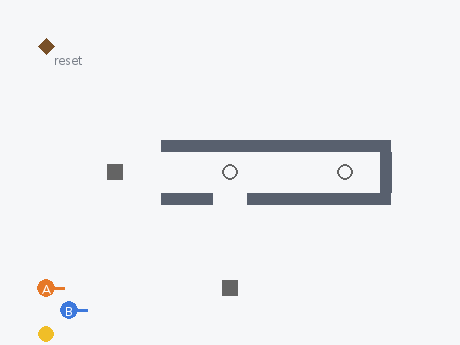 |
| `s18_assembly_line` | 조립 라인 | 작업 분배 | - | 원석 -> 주괴 -> 톱니바퀴가 유리벽 창구를 세 번 건너는 생산 라인. | 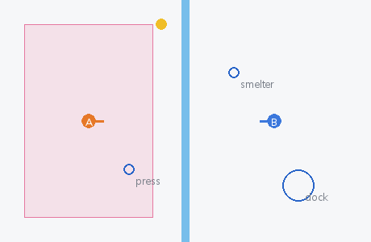 |
| `s19_hot_cargo` | 뜨거운 화물 | 시간 예측 | - | 한 사람이 오래 들 수 없고 들면 느려지는 화물을 이어 달리기로 배달. | 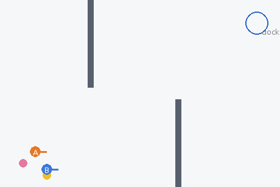 |
| `s20_scales` | 저울 맞추기 | 공동 추론 | - | 숨은 무게의 상자를 각자 방 저울로 재고, 합쳐서 금고 저울을 정확히 맞춤. | 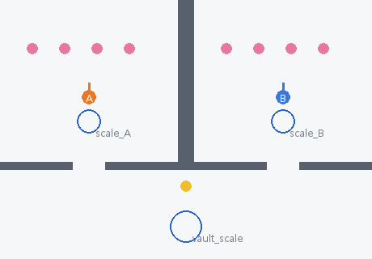 |
| `s21_silent_signs` | 흔적으로 말하기 | 간접 소통 | - | 메시지 금지. A만 코드를 읽고 B만 패널을 누름. 돌멩이와 매트로 뜻을 전달. | 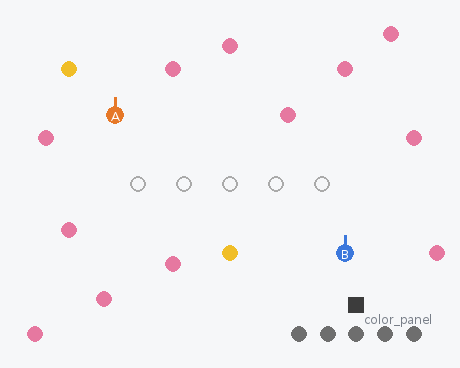 |
| `s22_narrow_bridge` | 좁은 다리 | 순서 계획 | - | 한 명만 버티는 다리로, 양쪽에서 생기는 상자를 서로 반대편에 배달. | 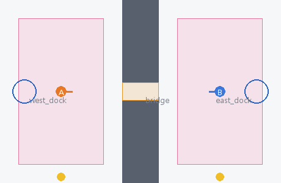 |
| `s23_key_chests` | 열쇠 상자 연쇄 | 작업 분배 | - | 열쇠와 상자가 두 구역에 엇갈려 있고, 유리 창구로만 주고받음. | 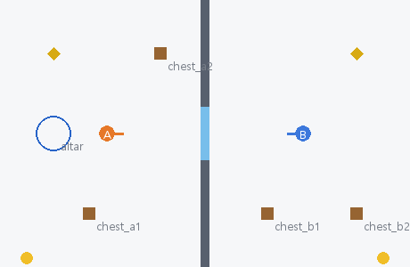 |
| `s24_shared_purse` | 공동 계좌 | 사회적 딜레마 | - | 문마다 공용 통행료(동전)를 내야 하는데, 남긴 동전은 개인 점수. | 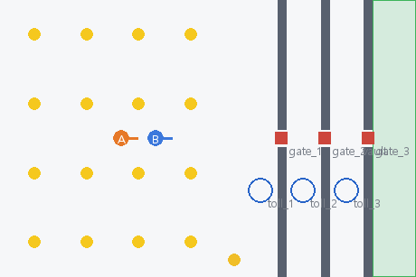 |
